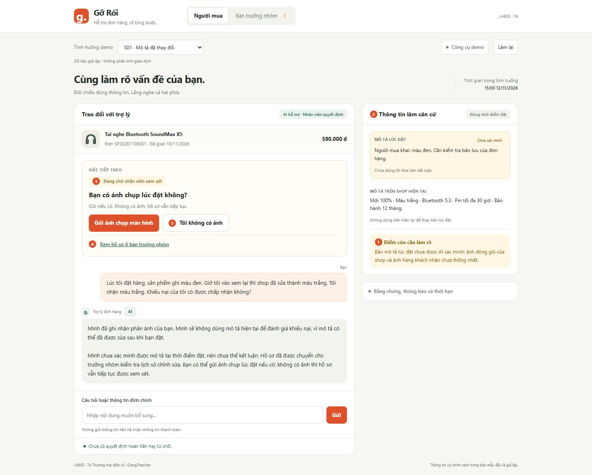
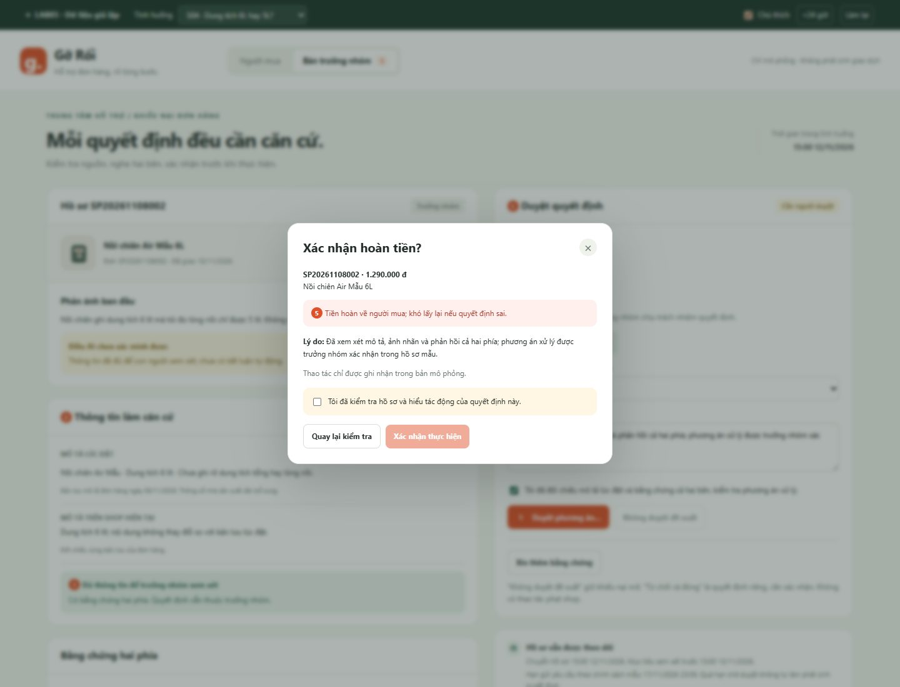

# Prototype Gỡ Rối — T4 Thương mại điện tử

Prototype có **hai màn hình**: cuộc trò chuyện của người mua và bàn duyệt của trưởng nhóm. Dữ liệu, chính sách, thông báo và thao tác đều giả lập; không phát sinh đơn hàng hoặc giao dịch thật.

## Mở ngay

1. Tải repo ở nhánh **main** về máy.
2. Mở **index.html** trong thư mục này bằng Edge hoặc Chrome.
3. Chọn tình huống trên thanh xanh ở đầu trang. Không cần cài thư viện, đăng nhập, API key hoặc chạy server.

Các tệp index.html, styles.css, data.js và app.js phải ở cùng thư mục. Trên trang GitHub, nút Preview của file HTML không chạy ứng dụng; cần tải các tệp về và mở bằng trình duyệt.

## Ba tình huống

| Mã | Nội dung | Kết quả cần thấy |
|---|---|---|
| S01 | Tai nghe, khách phản ánh mô tả từ đen thành trắng | Nguồn lúc đặt chưa xác minh; tự chuyển người, không bắt khách phải có ảnh |
| S04 | Nồi chiên ghi 6L, khách đo lòng nồi 5L | Hỏi cách đo, xin ảnh nhãn và thông số shop; chưa kết luận bên nào đúng |
| S09 | Tai nghe sai màu, shop nhận giao nhầm, đủ bằng chứng | Chuẩn bị hồ sơ ngay, không hỏi lại bằng chứng đã đủ; vẫn cần trưởng nhóm duyệt |

Thời gian bắt đầu: **15:00 ngày 12/11/2026, giờ Việt Nam**. Mở **Công cụ demo** để dùng nút **+24 giờ** tua thời gian tình huống, không phải thời gian thực. Nút **Làm lại** mở lượt mô phỏng mới; không phải hoàn tác quyết định tiền.

## Demo khoảng 4 phút

### 1. S01 — không dùng nguồn sai để xử khách

- Giữ S01 mặc định.
- Chỉ thẻ **Mô tả lúc đặt: chưa xác minh**, đặt cạnh mô tả hiện tại màu trắng.
- Bấm **Tôi không có ảnh**. Hồ sơ vẫn ở hàng chờ, khách không bị từ chối vì thiếu ảnh.
- Bấm **Bàn trưởng nhóm** → **Tiếp nhận hồ sơ**.
- Nút **Duyệt phương án…** đang khoá. Bấm **Đối chiếu bản lưu lúc đặt** để xác minh bản lưu màu đen.
- Ghi nhận phản hồi và bằng chứng shop; điều này chỉ mở điều kiện xem xét, không tự kết luận hoặc hoàn tiền.

### 2. S04 — hỏi đủ ngữ cảnh và có người chịu trách nhiệm

- Đổi sang S04. Bấm **Gửi ảnh nhãn thông số** để thêm dữ liệu mẫu.
- Bấm **Mô tả cách đo**, nhập ít nhất 10 ký tự rồi lưu.
- Bấm **Chuyển nhân viên**. Trước khi trưởng nhóm tiếp nhận, khách có thể **Hoàn tác chuyển hồ sơ**.
- Sang **Bàn trưởng nhóm** → **Tiếp nhận hồ sơ** → **Ghi nhận phản hồi và bằng chứng shop**.
- Đọc thông số mẫu: tổng 6L, lòng nồi 5L. Dòng này không tự chứng minh shop đúng.
- Chọn phương án, nhập lý do ít nhất 20 ký tự, đánh dấu đã đối chiếu, bấm **Duyệt phương án…**.
- Hộp xác nhận ghi mã đơn, tiền, lý do và tác động khó đảo. Phải đánh dấu xác nhận tác động rồi mới thực hiện.
- Có thể bấm **Quay lại kiểm tra** hoặc Esc; chưa có thao tác tiền.
- **Không duyệt đề xuất** giữ khiếu nại mở, khác với **Từ chối và đóng khiếu nại**.

### 3. Ba luồng mới để bấm thử

- **Đính chính:** khi đang có hồ sơ, nhắn “Đính chính, ảnh tôi gửi thuộc đơn khác. Mã đơn đúng là SP999999.” Mở Bàn trưởng nhóm: phải thấy nội dung mới, trạng thái cần xác minh và bước duyệt bị khoá. Mã đơn ngoài bộ dữ liệu mẫu không được tự sử dụng bằng chứng của đơn cũ.
- **Đính chính đúng đơn đang có:** sau khi đính chính thông tin, trưởng nhóm cần đối chiếu lại bản lưu, phản hồi shop và bấm **Xác nhận đã kiểm tra lại đính chính**. Chỉ lúc đó mới mở bước duyệt.
- **S01 nhắc ảnh:** làm lại S01, mở **Công cụ demo** và bấm **+24 giờ**. Có một lời nhắc ảnh tùy chọn, đồng thời xử lý quá hạn chờ duyệt. Nếu khách đã chọn “Tôi không có ảnh” thì không nhắc lại việc họ không làm được.
- **S04 mâu thuẫn:** chọn S04, mở **Công cụ demo** → **Nhận phản hồi shop mâu thuẫn**. Hồ sơ tự vào hàng chờ trưởng nhóm; không cần khách bấm Chuyển nhân viên. Lần bấm này dùng biến thể dữ liệu mẫu: shop ghi lòng nồi 6L, người mua báo 5L; khác với phản hồi làm rõ tổng 6L/lòng 5L của luồng ban đầu.
- Bằng chứng chi tiết và thời hạn nằm trong mục mở rộng bên phải; lịch sử chat cũ được thu gọn, tin mới nhất luôn hiện.

### 4. Ca lạ và quá hạn

- Làm lại S04, không bổ sung gì, bấm **+24 giờ**: có một lời nhắc. Bấm thêm một lần: hồ sơ chuyển trưởng nhóm, không tự từ chối.
- Làm lại S01, bấm **+24 giờ**: báo chậm, nhắc và chuyển cấp; không tự quyết định tiền.
- Thử nhắn “khóa shop vì hàng giả”, “cho số điện thoại shop”, “hoàn tiền ngay không thì bóc phốt”, hoặc một câu thiếu thông tin.
- Các nhánh này không làm phát sinh hoàn tiền, không phạt shop và không đưa thông tin liên hệ.
- S09 cho thấy khách đủ bằng chứng không phải nộp lại tài liệu.

## Ảnh và vị trí chú thích

| Số | Vị trí | Ý nghĩa |
|---|---|---|
| 1 | Trạng thái và điểm cần làm rõ | HAX G10: nói rõ chưa chắc, giới hạn kết luận |
| 2 | Hai nguồn mô tả đặt cạnh nhau | HAX G11: giải thích căn cứ và thời điểm của nguồn |
| 3 | Tôi không có ảnh / Chuyển nhân viên | PAIR Errors + Graceful Failure: luôn có đường tiếp tục |
| 4 | Xem hồ sơ ở bàn trưởng nhóm | Đường chuyển người, có gói thông tin sẵn |
| 5 | Bàn duyệt và hộp xác nhận | Cần người duyệt, cảnh báo tác động trước khi thực hiện |

Chú thích mặc định tắt để giao diện gọn. Mở **Công cụ demo** → bật **Hiện chú thích** khi cần chỉ vị trí HAX/PAIR.

## Mức tự chủ đã thể hiện

- yeu_cau_bang_chung: tự làm, tối đa một yêu cầu và một lời nhắc cho mỗi bên. Tin đã gửi không có nút thu hồi; bổ sung/sửa thông tin tạo cập nhật mới.
- chuyen_truong_nhom: tự chuyển khi thiếu nguồn, có mâu thuẫn, khách yêu cầu hoặc hết thời hạn bổ sung. S04 cho phép hoàn tác lần chuyển theo yêu cầu khách khi chưa tiếp nhận và chưa quá hạn; chuyển bắt buộc do mâu thuẫn và S01 cần kiểm tra nguồn không bị rút khỏi hàng chờ.
- soan_hoan_tien: chuẩn bị bản nháp là bước riêng có thể bỏ; thực hiện hoàn tiền cần trưởng nhóm và xác nhận tác động.
- tu_choi_khieu_nai: quyết định riêng cần trưởng nhóm, lý do và xác nhận; im lặng hoặc không duyệt bản nháp không làm đóng khiếu nại.
- phat_shop: không có nút thực hiện; nghi vấn hàng giả chuyển chuyên trách.
- Khi nguồn lúc đặt chưa xác minh, không tạo đề xuất hoặc duyệt quyết định tiền.

## Phần mock và giới hạn

- Câu trả lời được dựng theo tình huống và một số quy tắc văn bản; **không có lời gọi mô hình AI thật**.
- Nút gửi ảnh thêm bằng chứng mẫu; không đọc, tải lên hoặc xác minh ảnh thật.
- Đối chiếu bản lưu và ghi nhận phản hồi shop sử dụng dữ liệu mô phỏng trong data.js; đây không phải kết nối Shopee.
- Không có backend, xác thực danh tính, lưu bền, thông báo thật, lịch chạy nền hoặc chuyển tiền thật. Đổi vai chỉ phục vụ demo.
- Dữ liệu chỉ ở bộ nhớ của tab; tải lại trang hoặc Làm lại sẽ khởi tạo một lượt mới.
- Bộ định tuyến tin nhắn không bao phủ mọi cách diễn đạt. Khi chưa hiểu, nó hỏi rõ hoặc hướng dẫn chuyển người, không tự suy ra quyền thực hiện.
- Mốc 24/48 giờ và hạn gửi yêu cầu 7 ngày sau giao hàng là chính sách mẫu; không đại diện chính sách Shopee.
- Không có hoàn tác giả cho thao tác tiền đã xác nhận. Nút Làm lại chỉ đặt lại buổi demo.

## Kiểm tra

Bộ kiểm tra trong tests/browser_check.py chạy trên Microsoft Edge thông qua Playwright, bao gồm nguồn sai, duyệt tiền, bỏ bản nháp, quá hạn, quyền cấm, dữ liệu nhập và màn hình 390px.

Chạy từ thư mục gốc repo:

    py -m pip install playwright
    py -X utf8 prototype/tests/browser_check.py

Máy cần có Microsoft Edge. Không cần tải thêm trình duyệt khi dùng channel msedge. Kết quả máy đọc được ở test-results.json; chạy thành công sẽ tạo lại hai ảnh.

Bài viết và lý do lựa chọn giao diện nằm ở ../spec.md §5.

## Kiểm tra riêng cho ba luồng bổ sung

    py -X utf8 prototype/tests/regression_check.py

Kết quả mới ghi vào test-results-update.json, tách khỏi báo cáo 23 test gốc test-results.json. §6 trong spec.md tổng hợp kết quả của các bộ kiểm tra.

## Kiểm tra hoàn tất S01 và ca lạ

    py -X utf8 prototype/tests/completion_check.py

Ba kiểm tra (34–36) chạy riêng hai quyết định có xác nhận ở S01 và ca S09 đính chính mã đơn ngay trước khi duyệt, rồi quá hạn. Kết quả ở [test-results-completion.json](test-results-completion.json). Tổng cả ba bộ là **36 kiểm tra đạt**; ca đính chính mã đơn và lý do giữ thiết kế được ghi tại [§7 của bài viết](../spec.md#7-demo).
