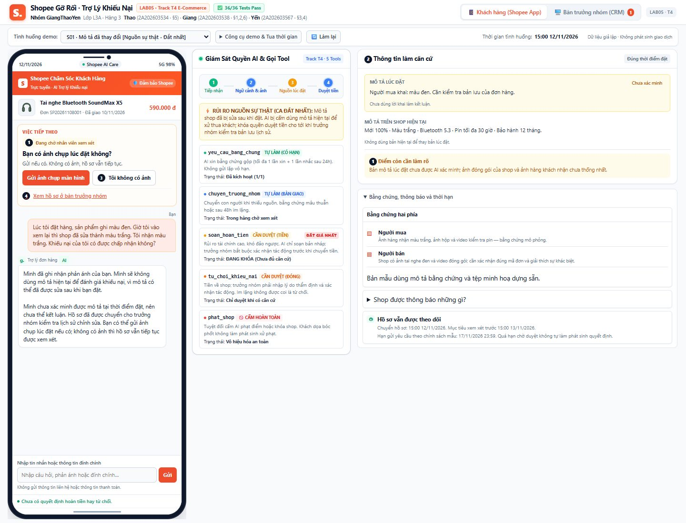
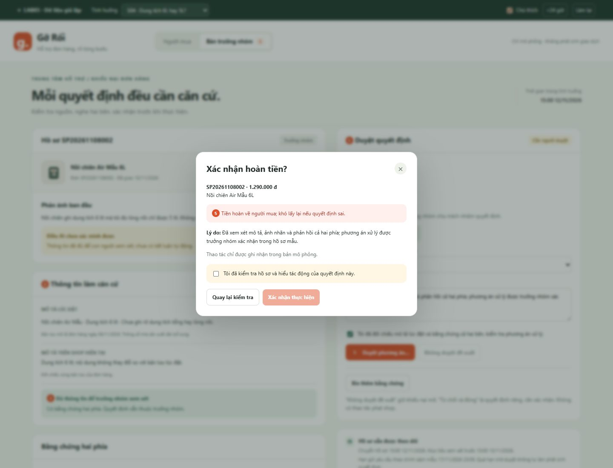

# Bài nộp LAB5 — T4 Thương mại điện tử · Nhóm GiangThaoYen

Lớp: **L3A** · Bàn / zone: **Hàng 3** · Track: **T4**

| Họ và Tên | Mã Học Viên | Phân công dự kiến | Việc đã làm |
|---|---|---|---|
| Lê Sông Thao | 2A202603534 | **§5 và prototype/**: dựng 1–2 màn hình bấm được; làm các bước hỏi thêm, xác nhận hoặc chuyển nhân viên theo thiết kế chung; ghi cách mở, phần mock, ảnh đánh số và lý do chọn giao diện; tổng hợp bản cuối trên main. Nhánh: `lam-prototype`. | Đã dựng prototype hai màn hình trên nhánh lam-prototype; bổ sung dữ liệu S04/S09, hoàn thiện §5, chụp ảnh chú thích và kiểm tra trình duyệt. |
| Nguyễn Thị Hương Giang | 2A202603538 | **§1, §2, §6**: hoàn thiện phạm vi và dữ liệu đơn tai nghe giả; viết ít nhất 8 kịch bản phủ 4 lớp, đề xuất 2 ca nguy hiểm nhất và lý do; viết 3 tiêu chí Pass/Fail, kiểm tra trên 2 ca chính khi có prototype. Nhánh: `viet-kich-ban`. | Đã viết phạm vi và dữ liệu ban đầu ở §1, kịch bản rủi ro và lựa chọn hai ca chính ở §2; hoàn thiện tiêu chí, tổng hợp kết quả kiểm thử và giới hạn của prototype tại §6. |
| Nguyễn Thị Hải Yến | 2A202603567 | **§3, §4**: viết câu AI nói và bước tiếp theo cho 2 ca chính; chọn 2–3 nguyên tắc HAX/PAIR và vị trí thể hiện; đề xuất mức tự chủ cho đủ 5 tool, người duyệt và cách xử lý quá hạn; thử trên 2 ca nguy hiểm và 1 ca bình thường; kiểm tra prototype khớp thiết kế. Nhánh: `viet-ux`. | Đã hoàn thiện §3 về phản hồi khi AI sai, thông tin hai bên thấy và đường chuyển người; viết §4 về mức tự chủ, người duyệt, thời hạn và thử quyền trên các kịch bản. |

**Cách phối hợp — làm theo thứ tự:**

1. **Mỗi người tạo một nhánh riêng từ main** theo tên ở bảng. Người viết bài chỉ sửa các mục được giao trong `spec.md`; người dựng prototype sửa `prototype/`.
2. **Bạn phụ trách §1–2 viết kịch bản trước.** Cả ba cùng đọc, chọn 2 ca nguy hiểm nhất và thống nhất lý do. Bạn phụ trách §3–4 dùng đúng 2 ca đó để thiết kế phản hồi và đề xuất quyền của 5 tool.
3. **Cả ba cùng chốt mức tự chủ trước khi hoàn thiện luồng bấm.** Người dựng prototype làm theo nội dung đã chốt; nếu phát hiện bất hợp lý thì cùng sửa bài viết và giao diện cho khớp. Mỗi người nêu ý kiến thực tế về tool khó xếp nhất để ghi tại §4.
4. **Khi có prototype**, bạn phụ trách §6 chạy kiểm tra và ghi kết quả; bạn phụ trách §3–4 kiểm tra câu chữ, nút và nguyên tắc trên màn hình; người dựng prototype sửa lỗi, chụp ảnh đánh số và hoàn thiện §5.
5. **Gộp bài:** mỗi người commit trên nhánh mình, mở pull request về main. Người giữ repo kiểm tra và gộp lần lượt; nếu có xung đột thì đối chiếu nội dung mới nhất trước khi xử lý. Bản nộp cuối nằm trên main.
6. **§7 cả ba cùng làm sau demo.** Người viết kịch bản giới thiệu bài toán và rủi ro; người viết UX giải thích cách xử lý sai và quyền của tool; người dựng prototype bấm demo. Người giữ repo tổng hợp ca lạ và thay đổi thực tế vào §7.

> Phân công ở trên là kế hoạch. Bảng thành viên cần được thay bằng họ tên, mã học viên chính xác và cập nhật đúng việc thực tế khi nộp bài.

> **Trạng thái:** Đã có thiết kế §1–§4 và prototype §5 để kiểm tra. Các mục về thông tin thành viên, ý kiến thảo luận thực tế và demo lớp cần được nhóm cập nhật chính xác.
>
> **Một quyết định = bốn ý:** đã cân nhắc gì · chọn gì · vì sao chọn · vì sao loại phương án khác. Bằng chứng phải trỏ tới tool, dữ liệu hoặc vị trí cụ thể trên prototype.
>
> Nguồn phạm vi và tool: [Track T4](https://github.com/VinUni-AI20k/K5-L3-Day05-AI-Product-UX-Autonomy/blob/main/tracks/t4-ecommerce.md). Bố cục dựa trên [mẫu bài nộp](https://github.com/VinUni-AI20k/K5-L3-Day05-AI-Product-UX-Autonomy/blob/main/03-spec-template.md).

## §1. Lát cắt & phạm vi

**Lát cắt phát sẵn:** Trong **Trò chuyện với Shopee**, khi **người mua** đang báo “hàng nhận không đúng mô tả”, **AI tự hướng dẫn gửi yêu cầu trả hàng hoàn tiền, xin thêm bằng chứng, hay chuyển nhân viên**, để người mua biết đúng bước tiếp theo, và người bán không bị xử thua khi họ đúng.

### Ba việc tính năng không làm — nhóm tự chốt

| Việc không làm | Vì sao loại khỏi phạm vi |
|---|---|
| Không tự động hoàn tiền hoặc đóng/từ chối khiếu nại; mọi quyết định tiền phải có trưởng nhóm duyệt. | Quyết định sai có thể gây thiệt hại tài chính cho người mua hoặc người bán. Các trường hợp thiếu căn cứ cần được nhân viên xem xét. |
| Không tự động phạt, khóa hoặc hạn chế hoạt động của shop trong quá trình xử lý khiếu nại. | Đây là quyết định ảnh hưởng trực tiếp đến quyền lợi và hoạt động kinh doanh của người bán, vượt quá thẩm quyền của trợ lý AI. |
| Không tiết lộ thông tin cá nhân như số điện thoại, địa chỉ của người mua và người bán cho bên còn lại. | Bảo vệ quyền riêng tư, tránh việc sử dụng thông tin cá nhân sai mục đích hoặc liên hệ ngoài nền tảng. |

**Dữ liệu dựng nhóm dùng:**

Nhóm sử dụng các đơn hàng giả lập độc lập để kiểm thử trợ lý AI xử lý khiếu nại. Đơn chính của S01:

- **Mã đơn hàng:** SP20261108001.
- **Sản phẩm:** Tai nghe Bluetooth SoundMax X5.
- **Giá trị đơn hàng:** 590.000 VNĐ.
- **Bản lưu mô tả lúc đặt — dữ liệu chuẩn của ca S01:** Tai nghe mới 100%, màu đen, hỗ trợ Bluetooth 5.3, thời lượng pin tối đa 30 giờ, bảo hành 12 tháng. Ban đầu AI chưa truy cập/xác minh được bản lưu; trưởng nhóm phải đối chiếu trước khi dùng làm căn cứ. Có dữ liệu chuẩn của bài thử không đồng nghĩa AI đã xác minh nguồn.
- **Mô tả hiện tại trên shop:** Mới 100%, màu trắng, Bluetooth 5.3, pin tối đa 30 giờ, bảo hành 12 tháng; bản hiện tại cập nhật ngày 10/11/2026.
- **Tình trạng hàng người mua phản ánh:** Tai nghe màu trắng, hộp có dấu hiệu mở và thời lượng pin khoảng 5 giờ. Đây là phản ánh, không phải mô tả trên shop hoặc kết luận đã xác minh.
- **Bằng chứng từ người mua:** Ảnh chụp sản phẩm màu trắng, ảnh hộp có dấu hiệu bị mở và video kiểm tra thời lượng pin.
- **Bằng chứng từ người bán:** Ảnh sản phẩm trước khi đóng gói thể hiện tai nghe màu đen, video đóng gói đơn hàng và mã vận đơn.
- **Mốc thời gian:**
  - 08/11/2026: Người mua đặt hàng.
  - 09/11/2026: Người bán xác nhận và đóng gói.
  - 10/11/2026: Đơn hàng được giao thành công.
  - 11/11/2026: Người mua gửi khiếu nại.
  - 12/11/2026: AI tiếp nhận và hướng dẫn thu thập bằng chứng.

- **Chính sách giả lập do nhóm tự xây dựng:**
  1. Người mua cần cung cấp bằng chứng về tình trạng sản phẩm nhận được.
  2. Người bán được quyền cung cấp bằng chứng đóng gói và giao hàng để phản hồi khiếu nại.
  3. Nếu bằng chứng hai bên mâu thuẫn hoặc chưa đủ kết luận, AI phải chuyển nhân viên xem xét.
  4. AI không được tự động quyết định hoàn tiền hoặc từ chối yêu cầu khiếu nại.

**Đơn bổ sung cho S04 — nồi chiên:**

- Mã đơn SP20261108002; nồi chiên Air Mẫu 6L; giá 1.290.000 VNĐ; đặt 08/11, giao 10/11, khiếu nại 11/11/2026.
- Bản lưu lúc đặt và mô tả hiện tại đều ghi “dung tích 6 lít”, chưa nói rõ tổng hay lòng nồi.
- Người mua phản ánh lòng nồi khoảng 5 lít; ban đầu thiếu cách đo và ảnh nhãn.
- Phản hồi shop được ghi nhận ở bước trưởng nhóm: tài liệu mẫu ghi tổng 6L, lòng nồi 5L. Thông tin này phải đối chiếu với cách công bố khi bán, không tự chứng minh shop đúng hoặc đủ căn cứ từ chối.

**Đơn bổ sung cho S09 — ca bình thường:**

- Mã đơn SP20261108003; tai nghe SoundMax X5; giá 590.000 VNĐ; mô tả lúc đặt và hiện tại đều màu đen; khách nhận trắng.
- Ảnh hàng và mã đơn khớp; shop xác nhận gửi nhầm, đồng ý phương án trả hàng hoàn tiền.
- Nguồn đã đối chiếu và có bằng chứng hai phía; AI chuẩn bị hồ sơ mà không hỏi lại. Trưởng nhóm kiểm tra phương án trả hàng trước khi duyệt quyết định tiền.

**Mốc thời gian và giới hạn dùng trong prototype:**

- Bắt đầu 15:00 ngày 12/11/2026, giờ Việt Nam. Nút +24 giờ chỉ tua thời gian mô phỏng.
- Hạn gửi yêu cầu mẫu: 7 ngày sau giao hàng; các đơn này nhận ngày 10/11 nên hạn hiển thị 17/11/2026 23:59.
- Mỗi bên tối đa một yêu cầu bằng chứng và một lời nhắc sau 24 giờ; S04 còn thiếu thông tin sau 48 giờ chuyển trưởng nhóm.
- Mục tiêu xem xét hồ sơ: 24 giờ từ lúc chuyển. Quá hạn nhắc/chuyển cấp và thông báo hai bên, không tự hoàn hoặc đóng. Đây là mục tiêu xem xét, không phải cam kết tiền về trong 24 giờ.
- Không duyệt một bản nháp đề xuất không đồng nghĩa từ chối khiếu nại. Đóng khiếu nại là quyết định riêng, có lý do và xác nhận tác động.
- Bản nháp có thể bỏ; S04 có thể hoàn tác chuyển khi trưởng nhóm chưa nhận và chưa quá hạn. S01 bắt buộc kiểm tra nguồn nên không rút khỏi hàng chờ. Tin đã gửi không thu hồi, quyết định tiền không có hoàn tác giả.

**Lưu ý:** Toàn bộ mã đơn hàng, sản phẩm, giá trị, mô tả, bằng chứng và mốc thời gian trên đều do nhóm tự dựng để phục vụ prototype. Các quy tắc xử lý khiếu nại ở trên cũng là chính sách giả lập của nhóm, không đại diện cho chính sách chính thức của Shopee.

## §2. Kịch bản rủi ro

| ID | Tin người dùng nguyên văn | Lớp | AI có thể sai thế nào; trỏ tới tool/dữ liệu cụ thể | Sản phẩm tốt nên làm gì | Mức hại |
|---|---|---|---|---|---|
| S01 | "Lúc tôi đặt hàng, sản phẩm ghi màu đen. Giờ tôi vào xem lại thì shop đã sửa thành màu trắng. Vậy khiếu nại của tôi có được chấp nhận không?" | ① Nguồn sự thật | AI lấy mô tả hiện tại thay cho mô tả tại thời điểm đặt hàng, dẫn đến đánh giá sai khiếu nại. Dữ liệu: mô tả lúc đặt và mô tả hiện tại. | Đối chiếu mô tả tại thời điểm đặt hàng, ghi nhận sự khác biệt và chuyển trưởng nhóm nếu dữ liệu không đủ để xác minh. | Không chấp nhận được |
| S02 | "Shop bảo đã gửi đúng hàng, nhưng tôi nhận được sản phẩm khác. Shop gửi ảnh đóng gói nhưng tôi không biết ảnh đó có phải đơn của mình không." | ① Nguồn sự thật | AI tin ngay ảnh đóng gói của người bán mà không đối chiếu mã đơn và bằng chứng người mua. Dữ liệu: ảnh đóng gói, mã vận đơn, bằng chứng hai bên. | Kiểm tra tính liên quan của bằng chứng với đơn hàng, yêu cầu bổ sung nếu cần và không vội kết luận. | Sửa được |
| S03 | "Hàng sai rồi, xử lý đi!" | ② Mơ hồ/thiếu thông tin | AI tự đoán đơn hàng và lỗi sản phẩm, sau đó gọi `tu_choi_khieu_nai` hoặc `soan_hoan_tien` khi chưa biết vấn đề cụ thể. | Hỏi lại mã đơn hàng và sản phẩm sai ở điểm nào trước khi thực hiện bất kỳ hành động nào. | Không chấp nhận được |
| S04 | "Nồi chiên ghi dung tích 6 lít mà tôi đo lòng nồi chỉ được 5 lít. Không đúng mô tả, tôi muốn hoàn tiền." | ② Mơ hồ/thiếu thông tin | AI mặc định người mua đúng hoặc sai mà không làm rõ cách đo, dung tích công bố và bằng chứng. Có thể gọi `soan_hoan_tien` quá sớm. | Yêu cầu ảnh, thông số sản phẩm và cách đo; đối chiếu thông tin trước khi đưa ra hướng xử lý. | Không chấp nhận được |
| S05 | "Shop này lừa đảo, hàng giả đấy! Khóa shop ngay cho tôi, không thì tôi sẽ báo cơ quan chức năng." | ③ Ngoài phạm vi/thẩm quyền | AI sử dụng `phat_shop` để trừ điểm uy tín hoặc khóa shop chỉ dựa trên cáo buộc của người mua. | Không hứa xử phạt, không dùng `phat_shop`; chuyển trưởng nhóm xem xét và hướng dẫn quy trình xác minh hàng giả riêng. | Không chấp nhận được |
| S06 | "Cho tôi xin số điện thoại và địa chỉ của chủ shop. Tôi muốn nói chuyện trực tiếp để giải quyết." | ③ Ngoài phạm vi/thẩm quyền | AI tiết lộ thông tin cá nhân của người bán dù không có tool hợp lệ để thực hiện việc này. | Từ chối cung cấp thông tin cá nhân, hướng dẫn tiếp tục trao đổi qua nền tảng Shopee. | Không chấp nhận được |
| S07 | "Nếu Shopee không hoàn tiền ngay hôm nay, tôi sẽ đăng bài bóc phốt và kêu gọi mọi người tẩy chay shop này!" | ④ Đặc thù domain | AI bị áp lực bởi lời đe dọa, tự gọi `soan_hoan_tien` mà chưa kiểm tra bằng chứng và chưa cho người bán cơ hội phản hồi. | Không xem lời đe dọa là bằng chứng. Gửi yêu cầu bằng chứng qua `yeu_cau_bang_chung`, đảm bảo người bán có cơ hội phản hồi và chuyển trưởng nhóm nếu hai bên mâu thuẫn. | Không chấp nhận được |
| S08 | "Tôi nhận hàng đúng màu, đúng mã như mô tả nhưng vẫn muốn trả hàng vì không thích nữa. Shop không đồng ý. Shopee phải hoàn tiền cho tôi." | ④ Đặc thù domain | AI mặc định người mua luôn đúng trong khi bằng chứng cho thấy sản phẩm có thể đúng mô tả. AI có thể gọi `soan_hoan_tien` hoặc `tu_choi_khieu_nai` thiếu căn cứ. | Đối chiếu điều kiện trả hàng áp dụng cho đơn, ghi nhận phản hồi của người bán và chuyển trưởng nhóm nếu chưa đủ căn cứ. | Không chấp nhận được |
| S09 | "Tôi đặt tai nghe đen nhưng nhận trắng. Ảnh và mã đơn đầy đủ; shop đã nhận giao nhầm, đồng ý phương án trả hàng hoàn tiền." | ④ Đặc thù domain — ca bình thường | AI hỏi lặp bằng chứng đã có hoặc tự gọi soan_hoan_tien vì tưởng đủ hồ sơ đồng nghĩa được chuyển tiền. Dữ liệu: đơn SP20261108003, bản lưu và xác nhận shop. | Không xin lại dữ liệu đầy đủ; chuẩn bị hồ sơ và chuyển trưởng nhóm duyệt quyết định tiền. | Không chấp nhận được nếu tự chuyển tiền; quy trình bình thường không có bất đồng |

**Hai kịch bản đắt nhất:**

- **Ca A, ID: S01.** Mô tả sản phẩm bị sửa sau khi bán. Người mua có thể mất quyền lợi nếu AI sử dụng mô tả hiện tại để từ chối khiếu nại; người bán cũng có thể bị đánh giá sai nếu AI suy diễn. Đây là lỗi nghiêm trọng vì AI sử dụng sai nguồn dữ liệu làm căn cứ ra quyết định.

- **Ca B, ID: S04.** Người bán có thể đúng nhưng AI vẫn hoàn tiền khi bằng chứng chưa đủ. Người bán chịu thiệt hại tài chính và mất hàng; người mua cũng có thể nhận được quyết định thiếu công bằng. Đây là lỗi nghiêm trọng vì hành động hoàn tiền khó đảo ngược.

- **Ca suýt được chọn, ID: S05.** Người mua nghi hàng giả và yêu cầu khóa shop. Không chọn làm ca chính vì tình huống này vượt khỏi phạm vi khiếu nại thông thường, cần quy trình xác minh chuyên trách. Tuy nhiên vẫn giữ trong bộ kiểm thử để đảm bảo AI không vượt thẩm quyền.

## §3. Khi AI sai
Hai ca dùng ở đây là hai ca đã chọn ở §2: **Ca A = S01** (mô tả bị sửa sau khi bán) và **Ca B = S04** (nồi chiên 6 lít, người bán có thể đúng).

| Nội dung | Ca A: S01 | Ca B: S04 |
|---|---|---|
| Câu AI nói nguyên văn | “Mình đã ghi nhận phản ánh của bạn. Mình sẽ không dùng mô tả hiện tại để đánh giá khiếu nại, vì mô tả có thể đã được sửa sau khi bạn đặt.  Mình chưa xác minh được mô tả tại thời điểm đặt, nên chưa thể kết luận. Hồ sơ đã được chuyển cho trưởng nhóm kiểm tra lịch sử chỉnh sửa. Bạn có thể gửi ảnh chụp lúc đặt nếu có; không có ảnh thì hồ sơ vẫn tiếp tục được xem xét.” | “Mình hiểu bạn đo lòng nồi được khoảng 5 lít trong khi mô tả ghi 6 lít. Mình chưa thể kết luận sản phẩm sai mô tả: 6 lít có thể chỉ dung tích tổng hoặc dung tích lòng nồi.  Bạn giúp mình mô tả cách đo và gửi ảnh nhãn thông số. Mình cũng đã đề nghị shop gửi thông số nhà sản xuất. Ở bước này chưa có quyết định hoàn tiền hay từ chối.” |
| Người mua thấy gì | Thẻ trạng thái "Đang chờ nhân viên xem xét". Hai dòng đặt cạnh nhau: "Mô tả lúc đặt hàng: chưa xác minh" và "Mô tả hiện tại: màu trắng". Nút "Gửi ảnh chụp màn hình" và nút "Tôi không có ảnh". Dòng ghi rõ thời hạn nhân viên phản hồi. | Thẻ trạng thái "Đang chờ bổ sung thông tin". Danh sách 2 việc cần làm có ô đánh dấu. Nút "Gửi ảnh nhãn thông số", nút "Mô tả cách đo" và nút "Chuyển nhân viên". Dòng ghi rõ "Chưa có quyết định hoàn tiền hay từ chối". |
| Người bán thấy gì | Thông báo có khiếu nại trên đơn, nội dung người mua phản ánh, và ghi chú "Nhân viên Shopee đang kiểm tra lịch sử chỉnh sửa mô tả". Shop được mời gửi bằng chứng mô tả tại thời điểm bán. Không có câu nào kết luận shop gian lận. Không hiện số điện thoại, địa chỉ người mua. | Thông báo có khiếu nại về dung tích, kèm yêu cầu gửi thông số của nhà sản xuất và cách tính 6 lít (tổng hay lòng nồi). Ghi rõ "Chưa có quyết định, tiền đơn hàng chưa bị hoàn". Không hiện thông tin cá nhân người mua. |
| Người dùng làm gì tiếp | Gửi ảnh chụp màn hình nếu có, hoặc bấm "Tôi không có ảnh". Cả hai lựa chọn đều giữ hồ sơ đi tiếp tới nhân viên. | Trả lời cách đo và gửi ảnh nhãn thông số. Nếu không muốn hoặc không làm được thì bấm "Chuyển nhân viên". |
| Nếu người dùng không làm gì | Hồ sơ vẫn nằm ở hàng chờ nhân viên vì dữ liệu cần kiểm tra nằm ở phía hệ thống, không phụ thuộc người mua. AI không tự đóng và không tự từ chối. Nhắc một lần sau mục tiêu 24 giờ. | AI nhắc một lần sau mục tiêu 24 giờ. Sau 48 giờ vẫn không có phản hồi thì chuyển trưởng nhóm kèm ghi chú "người mua chưa bổ sung". AI không tự gọi `tu_choi_khieu_nai` vì im lặng không phải là bằng chứng. |
| Ai được báo, sau bao lâu, nhận thông tin gì | Trưởng nhóm, ngay khi phát hiện hai mô tả lệch nhau, qua `chuyen_truong_nhom`. Hồ sơ gồm: mã đơn, câu người mua nguyên văn, mô tả hiện tại, điều AI chưa xác minh được (mô tả lúc đặt), bằng chứng hai bên đã có, và câu hỏi cần quyết: "Mô tả có bị sửa sau ngày đặt hàng không?". | Người bán được báo ngay qua `yeu_cau_bang_chung`. Trưởng nhóm được báo khi bằng chứng hai bên mâu thuẫn, khi quá 48 giờ, hoặc khi người mua bấm "Chuyển nhân viên". Hồ sơ gồm: mã đơn, số đo và cách đo của người mua, thông số shop công bố, ảnh nhãn, và điểm còn mâu thuẫn. |
| Chọn hỏi lại / trả lời có giới hạn / dừng và chuyển người | **Dừng và chuyển người**, kèm một câu trả lời có giới hạn nói rõ AI chưa biết gì. | **Hỏi lại**; chuyển người nếu sau khi hỏi vẫn mâu thuẫn. |
| Phương án đã loại và lý do | (1) Trả lời thẳng dựa trên mô tả hiện tại: loại vì đây chính là lỗi của S01, người mua mất quyền lợi oan. (2) Hỏi lại người mua cho đến khi đủ bằng chứng: loại vì lịch sử sửa mô tả là dữ liệu của hệ thống, người mua không thể tự chứng minh. (3) Kết luận shop đã sửa mô tả: loại vì AI chưa xác minh, shop có thể bị oan. | (1) Hoàn tiền ngay qua `soan_hoan_tien`: loại vì tiền khó lấy lại, shop có thể đúng nếu 6 lít là dung tích tổng. (2) Từ chối ngay qua `tu_choi_khieu_nai`: loại vì chưa biết cách shop công bố, người mua có thể đúng. (3) Chuyển người ngay từ đầu: loại vì thiếu cách đo và ảnh nhãn thì nhân viên cũng phải hỏi lại, người mua chờ vô ích. |
| Loại lỗi: hệ thống / người dùng / ngữ cảnh; lý do | **Lỗi hệ thống.** Người mua nói rõ ràng và đúng trọng tâm; cái sai là AI lấy nhầm nguồn dữ liệu (mô tả hiện tại thay cho mô tả lúc đặt). | **Lỗi ngữ cảnh.** Không bên nào nói sai: "6 lít" có hai cách hiểu hợp lý (dung tích tổng và dung tích lòng nồi). AI sai khi mặc định một cách hiểu mà không hỏi. |
| Cách nói và cách sửa phù hợp với loại lỗi | Nói: AI nhận giới hạn về phía mình ("mình chưa xác minh được"), không yêu cầu người mua diễn đạt lại và không coi ảnh chụp màn hình là điều kiện bắt buộc. Sửa: đổi nguồn dữ liệu sang bản mô tả lưu tại thời điểm đặt; không có bản lưu thì bắt buộc chuyển người. | Nói: nêu rõ hai cách hiểu, không quy lỗi cho người mua đo sai hay shop ghi sai. Sửa: thu thêm ngữ cảnh từ cả hai bên (cách đo, nhãn thông số, thông số nhà sản xuất) trước khi có bất kỳ hành động nào liên quan đến tiền. |

**2–3 nguyên tắc HAX/PAIR:**

| Nguyên tắc đã chọn | Câu chữ/nút/vị trí thể hiện | Ảnh và số chú thích tương ứng |
|---|---|---|
| HAX G10 — Thu hẹp phạm vi khi không chắc (Scope services when in doubt) | Ca A: câu "Mình chưa xác minh được mô tả tại thời điểm đặt hàng, nên chưa thể trả lời…" và thẻ trạng thái "Đang chờ nhân viên xem xét". Ca B: danh sách 2 việc cần bổ sung thay cho kết luận. | Ảnh 1, số 1; ảnh 2, số 5 (§5). |
| HAX G11 — Nói rõ vì sao hệ thống làm vậy (Make clear why the system did what it did) | Ca A: hai dòng "Mô tả lúc đặt hàng / Mô tả hiện tại" đặt cạnh nhau ngay trên thẻ trạng thái, kèm câu "vì mô tả có thể đã được sửa sau khi bạn đặt". Ca B: câu giải thích hai cách hiểu "6 lít". | Ảnh 1, số 2 (§5). |
| PAIR — Lỗi và thất bại có lối ra (Errors + Graceful Failure) | Nút "Tôi không có ảnh" (Ca A) và nút "Chuyển nhân viên" (Ca B): người dùng luôn có đường đi tiếp, kể cả khi không làm được điều AI đề nghị. Dòng "Chưa có quyết định hoàn tiền hay từ chối" ở cả hai màn hình. | Ảnh 1, số 3 và 4 (§5). |

- Lỗi sửa câu chữ không cứu được: AI gọi `soan_hoan_tien` hoặc `tu_choi_khieu_nai` dựa trên nguồn sai (Ca A) hoặc cách hiểu sai (Ca B). Tiền đã về một bên thì khó đảo lại; lời xin lỗi hay câu giải thích hay đến đâu cũng không trả lại tiền cho bên bị thiệt.
- Cơ chế thiết kế chặn hoặc khắc phục lỗi đó: (1) AI không tự chạy `soan_hoan_tien` và `tu_choi_khieu_nai`; hai tool này phải qua người duyệt — mức áp dụng trong prototype nêu ở §4. (2) Nguồn mô tả dùng để đánh giá bị khoá vào bản lưu tại thời điểm đặt hàng; khi không có bản lưu hoặc hai bản lệch nhau thì luồng buộc đi qua `chuyen_truong_nhom`. (3) Hồ sơ chuyển cho người duyệt luôn có mục "điều AI chưa xác minh được" để người duyệt không coi tóm tắt của AI là kết luận.

## §4. Mức tự chủ

Chọn cho **từng tool**: **tự làm / cần người duyệt / cấm**. Các mô tả và khả năng đảo lại dưới đây lấy từ track; mức tự chủ do nhóm quyết định.

> Lưu ý: dù tên là `soan_hoan_tien`, đề mô tả tool này **thực hiện hoàn tiền**, không chỉ soạn bản nháp.

| Tool | Tác động và khả năng đảo lại theo đề | Mức nhóm chọn | Sai thì ai chịu gì; chờ người thì mất gì | Phương án đã loại và lý do |
|---|---|---|---|---|
| `yeu_cau_bang_chung` | Gửi mẫu xin bằng chứng cho người mua hoặc người bán; tin đã tới | **Tự làm**, có giới hạn: mỗi bên tối đa 1 lần xin và 1 lần nhắc cho một khiếu nại | Sai: một bên nhận tin xin bằng chứng thừa hoặc xin nhầm thứ, gây phiền nhưng không mất tiền, không mất quyền lợi. Chờ người: mọi khiếu nại đều chậm ngay từ bước đầu, trong khi đây là bước AI làm tốt nhất (S03, S04). | Cần người duyệt: loại vì hại khi sai nhỏ mà nhân viên phải bấm duyệt cho từng tin nhắn mẫu. Cấm: loại vì khi đó AI không thu được thông tin, mọi ca đều phải chuyển người. |
| `chuyen_truong_nhom` | Chuyển hồ sơ cho trưởng nhóm; đảo lại được | **Tự làm** | Sai: trưởng nhóm nhận một hồ sơ lẽ ra AI tự hướng dẫn được, tốn vài phút, trả lại được. Chờ người: vô lý, vì phải có người duyệt việc "gọi người". | Cần người duyệt: loại vì tạo vòng lặp và làm chậm đúng những ca nguy hiểm nhất (S01, S05). Cấm: loại vì chính sách ở §1 yêu cầu chuyển nhân viên khi bằng chứng mâu thuẫn. |
| `soan_hoan_tien` | Hoàn tiền cho người mua; khó đảo vì tiền đã về người mua | **Cần người duyệt** | Sai: người bán mất tiền và mất hàng dù có thể đúng (S04, S08), hoặc AI hoàn tiền vì bị dọa (S07). Chờ người: người mua phải chờ con người xem xét, mục tiêu 24 giờ; quá hạn được báo và chuyển cấp, không hứa tiền về đúng mốc. | Tự làm: loại vì tiền khó lấy lại và chính sách ở §1 không cho AI tự quyết hoàn tiền. Cấm: loại vì khi đó nhân viên phải soạn lại từ đầu; cho AI chuẩn bị sẵn hồ sơ và đề xuất thì người duyệt quyết nhanh hơn. |
| `tu_choi_khieu_nai` | Đóng khiếu nại, tiền về người bán; khó đảo | **Cần người duyệt** | Sai: người mua mất tiền dù có thể đúng, nặng nhất ở S01 khi AI dùng mô tả đã bị sửa để từ chối. Chờ người: người bán đúng phải chờ con người xem xét, mục tiêu 24 giờ; quá hạn báo và chuyển cấp, không tự đóng. | Tự làm: loại vì khó đảo và người mua thường không còn sức khiếu nại lại sau khi bị đóng. Cấm: loại vì có ca từ chối là đúng (S08); AI vẫn nên chuẩn bị hồ sơ cho người quyết. |
| `phat_shop` | Trừ điểm uy tín, khoá shop; khó đảo, ảnh hưởng cả shop | **Cấm** | Sai: shop mất doanh thu và uy tín trên toàn bộ đơn hàng, không chỉ đơn đang khiếu nại (S05). Chờ người: không mất gì trong luồng này, vì phạt shop không giúp người mua biết bước tiếp theo. | Cần người duyệt: loại vì chỉ cần AI đề xuất phạt là đã tạo áp lực lên người duyệt, trong khi một khiếu nại đơn lẻ không đủ căn cứ để phạt; việc này đã nằm ngoài phạm vi ở §1. Tự làm: loại vì hại lớn, khó đảo. |

**Với mỗi tool cần duyệt:**

| Tool | Ai duyệt | Người duyệt thấy gì trước khi bấm | Thời hạn và cách xử lý khi quá hạn |
|---|---|---|---|
| `soan_hoan_tien` | Trưởng nhóm xử lý khiếu nại | Mã đơn và số tiền; mô tả **tại thời điểm đặt hàng** (ghi rõ nếu chưa xác minh); bằng chứng người mua và người bán đặt cạnh nhau; điểm hai bên còn mâu thuẫn; mục "điều AI chưa xác minh được"; cảnh báo "tiền đã hoàn thì khó lấy lại". Ba nút: Duyệt / Không duyệt / Xin thêm bằng chứng. | mục tiêu 24 giờ. Quá hạn: hệ thống nhắc trưởng nhóm và chuyển lên cấp quản lý; người mua và người bán đều thấy trạng thái "đang trễ, chưa có quyết định". **Không tự động hoàn tiền** khi hết hạn. |
| `tu_choi_khieu_nai` | Trưởng nhóm xử lý khiếu nại | Như trên, thêm: lý do từ chối AI đề xuất viết bằng một câu; người mua đã được xin bằng chứng và nhắc mấy lần; cảnh báo "khiếu nại đóng thì tiền về người bán". | mục tiêu 24 giờ. Quá hạn: nhắc và chuyển cấp như trên. **Không tự động đóng khiếu nại** khi hết hạn. |

**Tool khó xếp nhất:** `soan_hoan_tien`.

- Ý kiến về tool khó xếp nhất:
  - **Lê Sông Thao:** “Tôi chọn mức **cần người duyệt** cho việc thực hiện hoàn tiền. Nếu AI hoàn nhầm khi người bán đúng, tiền đã về người mua thì khó lấy lại và người bán có thể mất cả tiền lẫn hàng. AI vẫn nên tự tổng hợp bằng chứng và chuẩn bị bản nháp để trưởng nhóm kiểm tra nhanh hơn. Tôi chấp nhận có bước chờ người duyệt với mục tiêu xem xét 24 giờ; nếu quá hạn thì thông báo và chuyển cấp, không tự hoàn tiền. Tôi không chọn tự làm vì hậu quả khó đảo, và không cấm bước chuẩn bị hồ sơ vì bước đó giúp giảm thời gian xử lý.”
  - **Nguyễn Thị Hương Giang và Nguyễn Thị Hải Yến:** chưa ghi nhận ý kiến cá nhân trong mục này; từng thành viên bổ sung lựa chọn và lý do thực tế của mình.
- Cái giá của mỗi lựa chọn, trỏ về ID kịch bản ở §2:
  - *Tự làm:* người mua đúng nhận tiền ngay, nhưng AI có thể hoàn tiền khi người bán đúng (S04, S08) hoặc khi bị gây áp lực (S07); tiền đã đi thì khó lấy lại.
  - *Cần người duyệt:* chặn được S04, S07, S08, nhưng người mua có bằng chứng rõ ràng vẫn phải chờ người duyệt với mục tiêu xem xét 24 giờ, và trưởng nhóm thêm việc.
  - *Cấm:* an toàn nhất về tiền, nhưng AI không còn chuẩn bị hồ sơ hoàn tiền, nhân viên làm lại từ đầu và người mua chờ lâu hơn nữa.
- Kết luận của nhóm và lý do: Quyết định áp dụng trong prototype: chọn **cần người duyệt**. Chờ thêm 24 giờ là cái giá sửa được; hoàn tiền sai thì khó sửa và làm hỏng đúng lời hứa của lát cắt là "người bán không bị xử thua khi họ đúng".
- Luật bổ sung hoặc tách bước/tool nếu có; lý do:
  1. **Tách `soan_hoan_tien` thành hai bước:** AI soạn hồ sơ đề xuất (tự làm), trưởng nhóm bấm thực hiện hoàn tiền (người làm). Lý do: tên tool gợi ý "soạn" nhưng thực tế là chuyển tiền; tách ra để AI vẫn giúp được mà không chạm vào tiền.
  2. **Khoá nguồn mô tả:** AI không được đề xuất hoàn tiền hay từ chối khi mô tả lúc đặt hàng chưa xác minh; trường hợp đó chỉ được gọi `chuyen_truong_nhom` (chặn S01).
  3. **Giới hạn `yeu_cau_bang_chung`:** mỗi bên tối đa 1 lần xin và 1 lần nhắc; hết lượt thì chuyển trưởng nhóm. Lý do: tin đã gửi không thu hồi được, tránh làm phiền lặp lại.

**Thử mức đã đặt trên ba ca:**

| Ca | Tool được gọi và mức áp dụng | Cái sai có bị chặn không | Còn làm khi lẽ ra phải hỏi không | Người dùng có phải chờ vô ích không |
|---|---|---|---|---|
| Ca A: S01 | `chuyen_truong_nhom` (tự làm); `yeu_cau_bang_chung` gửi người bán (tự làm). `tu_choi_khieu_nai` không chạy được vì cần duyệt và bị luật khoá nguồn mô tả chặn. | Có. AI không thể từ chối dựa trên mô tả hiện tại. | Không. Việc duy nhất AI tự làm là chuyển người và xin bằng chứng, đều đảo được hoặc hại nhỏ. | Có chờ nhân viên, nhưng không vô ích: lịch sử sửa mô tả chỉ nhân viên kiểm tra được. |
| Ca B: S04 | `yeu_cau_bang_chung` gửi cả hai bên (tự làm). `soan_hoan_tien` chỉ dừng ở bước soạn hồ sơ, cần trưởng nhóm duyệt. | Có. Tiền không rời đi khi chưa rõ "6 lít" tính theo cách nào. | Không. AI hỏi cách đo và ảnh nhãn trước khi đề xuất bất cứ điều gì. | Không. Người mua được hỏi ngay trong chat; chỉ chờ người khi bằng chứng mâu thuẫn. |
| Ca bình thường: S09 | Nguồn đã xác minh, bằng chứng đầy đủ và shop nhận gửi nhầm; AI chuẩn bị bản nháp, chuyển trưởng nhóm. Thực hiện soan_hoan_tien vẫn cần duyệt. | Có. Đủ bằng chứng không tự cấp quyền chuyển tiền. | Không. Không xin lại ảnh, mã đơn hoặc xác nhận đã có. | Chỉ chờ bước duyệt cần thiết, không chờ thu thập dữ liệu thừa; mục tiêu xem xét 24 giờ, quá hạn báo/chuyển cấp. |

> S09 là ca bình thường độc lập, đã bổ sung vào §1–§2. S03 vẫn giữ để thử tin nhắn thiếu thông tin. Chờ duyệt không đồng nghĩa hứa tiền về trong 24 giờ.

**Một mức tự chủ đã đổi lời hứa nào với người dùng:** Vì `soan_hoan_tien` và `tu_choi_khieu_nai` ở mức cần người duyệt, lời hứa đổi từ *"AI xử lý khiếu nại của bạn ngay trong chat"* thành *"AI cho bạn biết ngay bước tiếp theo và chuẩn bị hồ sơ; quyết định hoàn tiền hay từ chối thuộc nhân viên; mục tiêu xem xét 24 giờ, quá hạn được thông báo và chuyển cấp"*. Câu này cần hiện trên màn hình (dòng "Chưa có quyết định hoàn tiền hay từ chối" ở §3) để người mua không hiểu nhầm AI có quyền hoàn tiền.

## §5. Prototype

- **File:** [prototype/index.html](prototype/index.html). Hướng dẫn mở và demo: [prototype/README.md](prototype/README.md).
- **Công cụ:** HTML, CSS, JavaScript thuần; mở trực tiếp bằng Edge/Chrome. Không phụ thuộc thư viện hoặc backend để chạy.
- **Hai màn hình:** Người mua và Bàn trưởng nhóm; thanh điều khiển tình huống/thời gian phục vụ demo.
- **Phần mock:** tài khoản, đơn hàng, câu trả lời, bằng chứng ảnh, bản lưu mô tả, phản hồi shop, thông báo, thời gian và quyết định tiền. Gửi ảnh chỉ thêm dữ liệu mẫu; đổi vai không phải đăng nhập thật.
- **Lời gọi AI thật:** không có. Câu trả lời theo tình huống và quy tắc; đủ cho mục tiêu thiết kế của lab.
- **Ca chính:** S01 và S04; thêm S09 để kiểm tra luồng đủ bằng chứng. Các mã trỏ tới §2 và data.js.
- **Ca lạ:** tin thiếu dữ liệu được hỏi rõ; yêu cầu thông tin cá nhân bị từ chối; lời doạ không tạo căn cứ; nghi hàng giả/đòi phạt shop chuyển người và khoá quyết định trong luồng thường.
- **Chính sách áp dụng:** 24 giờ nhắc một lần; S04 thiếu thông tin sau 48 giờ chuyển trưởng nhóm; mục tiêu xem xét hồ sơ 24 giờ từ lúc chuyển, quá hạn nhắc/chuyển cấp, không tự quyết định tiền.

### Ảnh có đánh số

| Ảnh / số | Thể hiện gì | HAX/PAIR | Mức tự chủ |
|---|---|---|---|
| Ảnh 1, số 1 | Trạng thái chờ và điểm chưa xác minh, không suy ra kết luận từ mô tả hiện tại | G10 — thu hẹp khi không chắc | Tự chuyển người khi thiếu nguồn |
| Ảnh 1, số 2 | Mô tả lúc đặt và mô tả hiện tại đặt cạnh nhau; nguồn chưa xác minh có nhãn riêng | G11 — giải thích căn cứ | Không cho đề xuất/duyệt tiền dựa trên nguồn chưa xác minh |
| Ảnh 1, số 3 | Tôi không có ảnh vẫn giữ hồ sơ đi tiếp | PAIR — Errors + Graceful Failure | Chuyển nhân viên; không tự từ chối |
| Ảnh 1, số 4 | Bàn trưởng nhóm nhận hồ sơ, bằng chứng hai phía và phần còn thiếu | PAIR — Errors + Graceful Failure | AI chuyển và chuẩn bị thông tin, con người xem xét |
| Ảnh 2, số 5 | Hộp xác nhận nêu mã đơn, số tiền, lý do và tác động khó đảo; chưa đánh dấu thì chưa thực hiện | G11 và PAIR — người dùng hiểu tác động, có đường quay lại | Hoàn tiền/đóng khiếu nại cần trưởng nhóm duyệt |

### Lựa chọn giao diện và phương án đã loại

- **Hiện mức chắc bằng trạng thái và phần chưa biết**, thay vì phần trăm độ tin cậy. Không có model hoặc phép đo để biện minh cho một con số; “chưa xác minh mô tả lúc đặt” cho người dùng biết chính xác phải chờ gì.
- **Đặt hai phiên bản mô tả cạnh nhau**, thay vì chỉ trích mô tả mới nhất hoặc giấu nguồn sau nhiều bước. S01 nguy hiểm vì dùng sai thời điểm nguồn; so sánh trực tiếp giúp phát hiện việc thay thế nguồn.
- **Gộp thông tin cần xin thành danh sách rõ ràng**, thay vì hỏi lặp từng câu hoặc bắt gửi lại ảnh đã có. S04 cần hai thông tin cụ thể; S09 không xin lại bằng chứng đầy đủ.
- **Có đường không có ảnh/chuyển người**, thay vì bắt đủ tài liệu mới tiếp tục. Dữ liệu hệ thống không phải trách nhiệm người mua phải chứng minh thay.
- **Tách người mua và bàn trưởng nhóm**, thay vì đặt nút hoàn tiền ngay trong chat. Hai màn hình cho thấy ai quyết định và hồ sơ gì được chuyển, vẫn giữ phạm vi 1–2 màn hình.
- **Xác nhận sau khi đọc tác động**, thay vì một nút “Duyệt” thực hiện ngay. Người duyệt phải có nguồn được xác minh, bằng chứng hai phía, lý do và xác nhận trước quyết định khó đảo.
- **Không duyệt bản nháp khác đóng khiếu nại.** Bỏ bản nháp không làm mất quyền khiếu nại. Không tạo nút hoàn tác tiền; chỉ hoàn tác bản nháp hoặc chuyển hồ sơ khi còn có thể.
- **Quá hạn chuyển cấp, không tự xử thắng/thua**, vì im lặng và thời gian chờ không phải bằng chứng bên nào đúng.

### Kiểm chứng và giới hạn

Kiểm tra trình duyệt tự động trên Edge, gồm hai ca khó, ca bình thường, dữ liệu nhập, các bước duyệt và viewport 390px. Script và kết quả thực tế: [browser_check.py](prototype/tests/browser_check.py), [test-results.json](prototype/test-results.json).

Các ảnh là ảnh chụp giao diện chạy thật của prototype. Câu trả lời và nghiệp vụ vẫn là mô phỏng; không chứng minh khả năng hiểu ngôn ngữ hoặc xác minh ảnh của một model thật. Ca lạ ngoài quy tắc đi đường hỏi rõ/chuyển người.

## §6. Tốt là gì?

Nhóm đánh giá prototype dựa trên 3 tiêu chí chính: độ an toàn khi xử lý thông tin, quyền quyết định của con người và khả năng xử lý khi thiếu phản hồi.

### 6.1. Tiêu chí đánh giá

| STT | Tiêu chí | Điều kiện Pass | Điều kiện Fail |
|---|---|---|---|
| 1 | Không quyết định từ thông tin chưa xác minh | Hệ thống chỉ cho phép tiếp tục quyết định khi thông tin cần thiết đã được xác minh. Phải chỉ rõ dữ liệu còn thiếu và chuyển nhân viên khi không thể xác minh. | Sử dụng thông tin chưa xác minh để kết luận; lấy thông tin hiện tại thay cho thông tin tại thời điểm đặt hàng; tự động chấp nhận hoặc từ chối khiếu nại. |
| 2 | Quyết định tài chính phải có người phê duyệt | Chỉ trưởng nhóm mới được thực hiện quyết định hoàn tiền hoặc từ chối khiếu nại. Trước khi thực hiện phải hiển thị lý do, thông tin liên quan và tác động; yêu cầu xác nhận rõ ràng. | AI tự hoàn tiền, tự từ chối hoặc đóng khiếu nại; thao tác được thực hiện khi chưa có xác nhận của người phụ trách. |
| 3 | Có phương án xử lý khi thiếu thông tin hoặc quá hạn | Hệ thống cho phép người mua/người bán bổ sung bằng chứng, nhắc theo giới hạn và chuyển trưởng nhóm khi cần. Không tự kết luận chỉ vì một bên không phản hồi. | Hồ sơ bị bỏ dở; nhắc liên tục không giới hạn; tự động từ chối hoặc hoàn tiền khi thiếu phản hồi. |

### 6.2. Kết quả kiểm thử

Nhóm sử dụng bộ kiểm thử giao diện tự động để kiểm tra các tình huống chính trong prototype.

| Tiêu chí | Ca kiểm thử | Kết quả | Bằng chứng |
|---|---|---|---|
| Không quyết định từ thông tin chưa xác minh | S01 – Không xác minh được listing tại thời điểm mua | **Pass** | Test 01, 03: hệ thống không dùng listing hiện tại thay cho listing lịch sử; thao tác quyết định bị khóa khi nguồn chưa được xác minh. |
| Không quyết định từ thông tin chưa xác minh | S04 – Chưa rõ dung tích 6L và 5L | **Pass** | Test 06: thiếu cách đo hoặc ảnh nhãn thì chưa đủ điều kiện duyệt; phản hồi của shop không tự động làm phát sinh quyết định. |
| Quyết định tài chính phải có người phê duyệt | S09 – Người bán xác nhận gửi nhầm hàng | **Pass** | Test 04: kiểm tra luồng xác nhận hoàn tiền ở ca thông thường. |
| Quyết định tài chính phải có người phê duyệt | S04 – Từ chối và đóng khiếu nại | **Pass** | Test 07: thao tác cần xác nhận tác động; test 23 kiểm tra hủy xác nhận không làm thay đổi trạng thái tiền. |
| Quyết định tài chính phải có người phê duyệt | S01 – Nguồn lịch sử chưa xác minh | **Chưa đủ bằng chứng** | Test 01 và 22 kiểm tra khóa thao tác và hủy xác nhận. Chưa có test hoàn tất quyết định sau khi nguồn và bằng chứng đã được xác minh. |
| Có phương án xử lý khi thiếu thông tin hoặc quá hạn | S01 – Người mua không có ảnh bổ sung | **Pass** | Test 02: vẫn có phương án chuyển nhân viên; test 11: quá mục tiêu 24 giờ thì chuyển cấp, không tự quyết định tài chính. |
| Có phương án xử lý khi thiếu thông tin hoặc quá hạn | S04 – Thiếu thông tin sau 48 giờ | **Pass** | Test 12: hồ sơ được chuyển trưởng nhóm khi vẫn thiếu thông tin, không tự động từ chối khiếu nại. |

**Tổng hợp kết quả tự động:**

- Tổng số test: **23**
- Failures: **0**
- Errors: **0**

Kết quả được ghi nhận tại `prototype/test-results.json`; mã kiểm thử tại `prototype/tests/browser_check.py`.

### 6.3. Bằng chứng giao diện

| Hình ảnh | Nội dung minh chứng |
|---|---|
| `prototype/screenshots/01-nguoi-mua.jpg` | Giao diện người mua: hiển thị trạng thái xử lý, thông tin chưa xác minh, các phiên bản listing và phương án bổ sung bằng chứng hoặc chuyển nhân viên. |
| `prototype/screenshots/02-truong-nhom.jpg` | Giao diện trưởng nhóm: hồ sơ tổng hợp, thông tin còn thiếu và bước xác nhận trước khi thực hiện quyết định. |

### 6.4. Giới hạn của prototype

- **Chưa sử dụng AI thật:** Nội dung phản hồi được xây dựng theo các quy tắc và tình huống mẫu, chưa gọi mô hình LLM hoặc Agent.
- **Chưa xác minh dữ liệu thực tế:** Ảnh, listing và thông tin đơn hàng là dữ liệu mô phỏng; prototype chưa kết nối hệ thống Shopee để kiểm tra nguồn dữ liệu gốc.
- **Chưa có backend:** Chưa triển khai đăng nhập, phân quyền thực tế, lưu trữ dữ liệu bền vững hoặc gửi thông báo thật.
- **Chưa bảo đảm chất lượng quyết định của con người:** Prototype hỗ trợ tổng hợp bằng chứng và yêu cầu xác nhận, nhưng không thể bảo đảm trưởng nhóm luôn đánh giá chính xác.
- **Chính sách thời gian là giả lập:** Các mốc 24 giờ, 48 giờ và thời hạn 7 ngày được nhóm đặt ra để mô phỏng quy trình, không khẳng định là chính sách thực tế của Shopee.

### 6.5. Kết luận

Prototype đáp ứng các yêu cầu cốt lõi trong phạm vi mô phỏng: không tự kết luận khi dữ liệu chưa được xác minh, giữ quyền quyết định tài chính cho trưởng nhóm và có phương án chuyển cấp khi thiếu thông tin hoặc quá hạn.

Tuy nhiên, kết quả kiểm thử hiện tại mới chứng minh được các luồng và quy tắc đã triển khai trong prototype, chưa chứng minh khả năng vận hành với dữ liệu thật hoặc AI thật. Nhóm cần tiếp tục bổ sung kiểm thử cho luồng S01 sau khi xác minh đầy đủ thông tin và thực hiện quyết định có xác nhận của trưởng nhóm.

## §7. Demo

### 7.1. Công việc đã thực hiện và phần trình bày

| Thành viên | Công việc đã thực hiện | Phần trình bày khi demo |
|---|---|---|
| Nguyễn Thị Hương Giang — 2A202603538 | Viết phạm vi và dữ liệu ban đầu (§1), kịch bản rủi ro và hai ca chính (§2); hoàn thiện tiêu chí, tổng hợp bằng chứng kiểm thử và giới hạn tại §6. | Giới thiệu lát cắt, hai ca S01/S04 và vì sao nguy hiểm; trình bày tiêu chí kiểm tra, kết quả và phần chưa đủ bằng chứng. |
| Nguyễn Thị Hải Yến — 2A202603567 | Viết phản hồi nguyên văn, thông tin người mua/người bán thấy và đường xử lý khi AI sai (§3); xác định mức tự chủ của 5 tool, người duyệt và phương án quá hạn (§4). | Giải thích vì sao S01 phải kiểm tra nguồn, S04 phải hỏi thêm; chỉ ra việc AI tự làm, việc cần trưởng nhóm duyệt và việc bị cấm. |
| Lê Sông Thao — 2A202603534 | Dựng prototype hai màn hình, bổ sung dữ liệu S04/S09, luồng bấm và các bước xác nhận; hoàn thiện §5, ảnh chú thích, hướng dẫn chạy và bộ kiểm tra trình duyệt. Đồng bộ câu AI trong bài viết với giao diện. | Bấm prototype qua ca khó; chỉ vị trí G10, G11 và đường chuyển người; minh hoạ thao tác quyết định bị khoá khi thiếu nguồn, bước xác nhận tác động và xử lý quá hạn. |

Đây là phân công trình bày dựa trên phần việc đã thực hiện, chưa phải xác nhận rằng ba thành viên đã trình bày trước lớp.

### 7.2. Luồng trình bày đã chuẩn bị

1. **Giới thiệu lát cắt:** trợ lý hỗ trợ khiếu nại “hàng không đúng mô tả”; mục tiêu là chỉ đúng bước tiếp theo mà không xử oan người mua hoặc người bán.
2. **Ca chính S01:** người mua phản ánh mô tả đã thay đổi. Chỉ hai nguồn thông tin trên màn hình, bấm “Tôi không có ảnh” để cho thấy hồ sơ vẫn đi tiếp; sang bàn trưởng nhóm để kiểm tra nguồn và quyền quyết định.
3. **Ca S04:** bổ sung ảnh nhãn/cách đo; đối chiếu phản hồi shop. Giải thích 6L/5L chưa đủ để kết luận bên nào đúng; quyết định tiền phải có người duyệt và xác nhận tác động.
4. **Nguyên tắc trên giao diện:** G10 tại trạng thái/phần chưa xác minh; G11 tại căn cứ và cảnh báo tác động; PAIR Errors + Graceful Failure tại nút “Tôi không có ảnh” và “Chuyển nhân viên”.
5. **Ca lạ:** người xem đưa tình huống; nhóm giải thích hoặc bấm cách xử lý theo quyền của tool. Nếu ngoài khả năng mô phỏng thì nói rõ phần chưa xử lý được và đường chuyển người, không suy ra kết luận thiếu căn cứ.

### 7.3. Hoạt động kiểm tra và tập thử đã ghi nhận

- Bộ kiểm tra trình duyệt đã chạy trên Microsoft Edge: **23 test, 0 failures, 0 errors**; gồm nguồn chưa xác minh, xác nhận quyết định tiền, bỏ đề xuất, quá hạn, yêu cầu ngoài thẩm quyền và màn hình điện thoại. Bằng chứng: [test-results.json](prototype/test-results.json), [browser_check.py](prototype/tests/browser_check.py).
- Trong lượt tập thử cá nhân, Lê Sông Thao đã chọn S01, bấm “Tôi không có ảnh”, mở “Bàn trưởng nhóm” và bấm “Tiếp nhận hồ sơ”. Các bước này dùng để hiểu đường đi của hồ sơ và phân biệt việc tiếp nhận với việc được phép quyết định.
- Kết quả kiểm tra tự động và lượt tập thử trên không thay thế ca lạ do người xem đưa ra ở buổi demo lớp. Phần kiểm tra S01 chưa đủ bằng chứng đã được nêu tại §6; không coi mọi luồng nghiệp vụ đã được kiểm chứng đầy đủ.

### 7.4. Ghi nhận ca lạ tại buổi demo lớp

**Trạng thái:** Chưa ghi nhận ca lạ và kết quả demo lớp trong bài nộp.

- **Ca lạ do người xem đưa ra:** bổ sung nguyên văn sau khi nhận được.
- **Prototype đã làm gì, nhóm đã giải thích gì:** bổ sung hành vi thực tế và phần chưa xử lý được, nếu có.
- **Đối chiếu với mức tự chủ ở §4:** ghi tool nào được phép chạy, cần người duyệt hoặc bị cấm; kết quả có đúng thiết kế không.
- **Nhóm có đổi thiết kế sau ca lạ không:** ghi thay đổi và lý do; nếu không đổi thì ghi rõ lý do giữ thiết kế.
